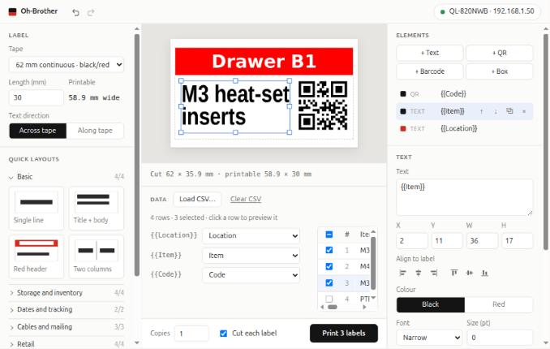
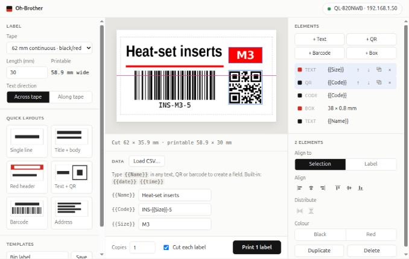

# Oh-Brother

Label printing for a network Brother QL-820NWB, in black or in black and red. It's a local web app that runs from its own folder, with nothing installed on the host, so it can live on a thumbdrive.

> **Status: pre-release.** Version 0.2.2 is the current build. Anything may change. See the [roadmap](ROADMAP.md) and [changelog](CHANGELOG.md).



## Requirements

- A Brother QL-820NWB on the network. Other two-colour QL models (QL-800, QL-810W) are selectable but untested.
- For red: DK-2251 tape (62 mm, black and red), also sold as the DK-22513 3-pack.
- Linux on x86_64. Other platforms: see the [roadmap](ROADMAP.md).

## Run

On a fresh copy, run `sh build.sh` once (it needs internet). Then:

```sh
sh run.sh
```

The app opens in a new window of your default browser (on macOS it may be a tab). Click the printer chip (top right) and enter the printer's IP address. The printer's port is 9100, which is already filled in.

The app stops by itself about 10 seconds after you close its last window or tab, so a reload won't stop it. Ctrl+C in the terminal also stops it.

| Option | Effect |
|---|---|
| `--no-browser` | Don't open a browser; keep running until Ctrl+C |
| `--port N` | Port for the app in your browser (default 8620; the next free one is used if it's taken) |
| `--data DIR` | Use another data folder for templates and the printer address (default `data` next to `run.sh`) |
| `--lan` | Allow other devices on the network to use the app. It keeps running until Ctrl+C. There's no login, so only use this on a trusted network. |

## Use

- **Label:** tape, length (continuous tape), and text direction (across or along the tape). The layout scales when these change.
- **Units:** millimetres or inches, for every length you see or type. Templates work in either. The app remembers your choice.
- **Quick layouts** replace the current elements with a starting layout, arranged for the label's shape: on long, narrow labels, parts sit side by side. The thumbnails show each layout as it would come out on the current label, and layouts that can't fit are greyed out. Values you've typed carry over, since the layouts share field names (`{{Title}}`, `{{Body}}`, `{{Code}}`, `{{Price}}`).
  - **Basic:** single line, title and body, red header, two columns.
  - **Storage and inventory:** text and QR code, barcode, QR only, bin label.
  - **Dates and tracking:** date stamp ("Opened" and today's date), filament spool ("Dried" and today's date).
  - **Cables and mailing:** cable flag, address, return address. The cable flag prints the text twice with 15 mm of blank tape between, which wraps around a cable up to about 4.5 mm thick; the two ends stick together back to back.
  - **Retail:** price tags in black, and sale tags with a red banner and price, each with a barcode or QR code of the SKU (`{{Code}}`). Sale tags need red tape.
- **Undo:** Ctrl+Z, or the arrows in the top bar, undoes the last 100 changes. Redo with Ctrl+Shift+Z or Ctrl+Y. Inside a text box, these keys undo typing in that box.
- **Editor:** the label is shown at its cut size. The dashed line is the printable area.
- **Elements:** text, QR code, Code 128 barcode, and box or line, each in black or red.
  - Drag to move. Drag a corner or edge handle to resize.
  - Edges and centres snap to the printable area's edges and centre, and to other elements, with a guide line. Otherwise they snap to a 0.5 mm grid (0.02 in when using inches). Hold Alt to place freely.
  - The align buttons place the selected element at the left, centre or right, and top, middle or bottom of the printable area.
  - Arrow keys nudge the selection (Shift for bigger steps). Delete removes it.
  - Text size 0 shrinks the text to fit its box.
  - While you type in a text field, its element is outlined on the label and tagged *Editing*. Double-click an element on the label to jump to its text.
- **Several elements:** Shift- or Ctrl-click to add or remove one, drag across empty space to select every element the rectangle touches, or press Ctrl+A. Drag any of them to move them together.
  - Align them to each other (Selection) or to the printable area (Label).
  - Distribute three or more with equal gaps. The outermost two stay put.
  - Colour, Duplicate and Delete apply to all of them.
- **Fields:** `{{Name}}` in any text, QR code or barcode becomes a field. Fill it with fixed text or a CSV column. Built-in fields: `{{date}}`, `{{time}}` and `{{datetime}}`.
  - Fixed text can include other fields: set Code to `{{Item}}` or `P-{{Item}}-{{date}}`. It can also name any CSV column, even one the label doesn't use. A field named only here gets its own row.
  - Values from CSV cells are printed exactly as written, `{{…}}` included.
  - Fields that refer to each other in a loop are left blank on the label, and a warning names them.
- **CSV:** load a file, map fields to columns, click a row to preview it, and tick the rows to print.
- **Templates** save the layout, fixed values and column mapping. A sample CSV in `data/samples/` matches the *Bin label* template.



The preview is exactly what prints. Over the network the printer doesn't report back, so "Sent" means the job reached it.

## Thumbdrives

- Start the app with `sh run.sh` rather than `./run.sh`, since FAT32 and exFAT don't keep the executable flag.
- If the drive doesn't allow running programs, the Python runtime (about 110 MB) is copied once to `~/.cache/oh-brother/`. Your settings and templates stay on the drive.

## Development

See [development](docs/development.md) for the folder layout, how printing works, and third-party code.

## License

GPL-3.0. See [LICENSE](LICENSE). Bundled fonts keep their own licences, listed in [development](docs/development.md#third-party-code).
