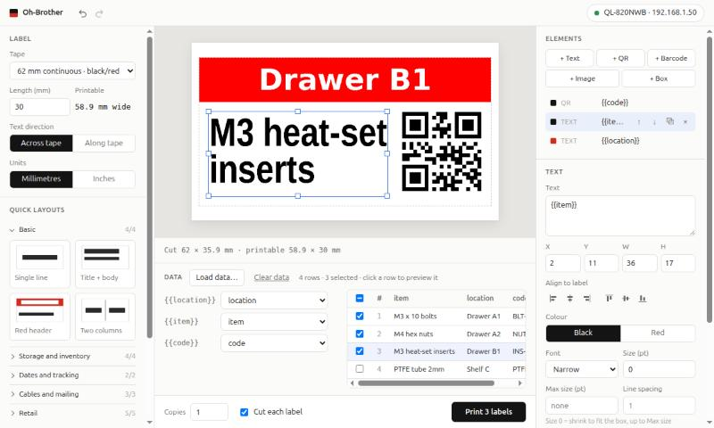
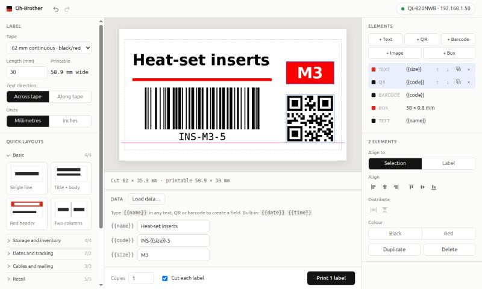
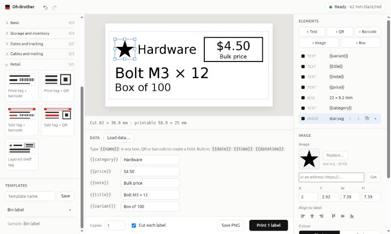

# Oh-Brother

Label printing for a network Brother QL-820NWB, in black or in black and red. It's a local web app that runs from its own folder, with nothing installed on the host, so it can live on a thumbdrive.

> **Status: pre-release.** Version 0.5.0 is the current build. Anything may change. See the [roadmap](ROADMAP.md) and [changelog](CHANGELOG.md).



## Requirements

- A Brother QL-820NWB on the network. Other two-colour QL models (QL-800, QL-810W) are selectable but untested.
- For red: DK-2251 tape (62 mm, black and red), also sold as the DK-22513 3-pack.
- Linux on x86_64. Builds for ARM Linux and macOS pass the tests on every change, but haven't been tried in real use: see the [roadmap](ROADMAP.md).

## Run

On a fresh copy, run `sh build.sh` once (it needs internet). Then:

```sh
sh run.sh
```

The app opens in a new window of your default browser (on macOS it may be a tab). Click the printer chip (top right) and enter the printer's IP address. The printer's port is 9100, which is already filled in.

The app stops by itself about 10 seconds after you close its last window or tab, so a reload won't stop it. Ctrl+C in the terminal also stops it.

| Option | Effect |
|---|---|
| `--no-browser` | Don't open a browser; keep running until Ctrl+C |
| `--port N` | Port for the app in your browser (default 8620; the next free one is used if it's taken) |
| `--data DIR` | Use another data folder for templates and the printer address (default `data` next to `run.sh`) |
| `--lan` | Allow other devices on the network to use the app, and print the address they use. It keeps running until Ctrl+C. There's no login, so only use this on a trusted network. |

## Use

- **Label:** tape, length (continuous tape), and text direction (across or along the tape). The layout scales when these change.
- **Units:** millimetres or inches, for every length you see or type. Templates work in either. The app remembers your choice.
- **Quick layouts** replace the current elements with a starting layout, arranged for the label's shape: on long, narrow labels, parts sit side by side. The thumbnails show each layout as it would come out on the current label, and layouts that can't fit are greyed out. Values you've typed carry over, since the layouts share field names (`{{title}}`, `{{body}}`, `{{code}}`, `{{price}}`), and so does an image you've chosen.
  - **Basic:** single line, title and body, red header, two columns.
  - **Storage and inventory:** text and QR code, barcode, QR only, bin label.
  - **Dates and tracking:** date stamp ("Opened" and today's date), filament spool ("Dried" and today's date).
  - **Cables and mailing:** cable flag, address, return address. The cable flag prints the text twice with 15 mm of blank tape between, which wraps around a cable up to about 4.5 mm thick; the two ends stick together back to back.
  - **Retail:** price tags in black, and sale tags with a red banner and price, each with a barcode or QR code of the SKU (`{{code}}`). Sale tags need red tape. The layered shelf tag has an image slot for a logo or symbol beside `{{category}}`, the price in an outlined box with an optional `{{note}}` under it, then `{{title}}` and `{{variant}}`.
- **Undo:** Ctrl+Z, or the arrows in the top bar, undoes the last 100 changes. Redo with Ctrl+Shift+Z or Ctrl+Y. Inside a text box, these keys undo typing in that box.
- **Editor:** the label is shown at its cut size. The dashed line is the printable area.
- **Elements:** text, QR code, barcode, image, and box or line, each in black or red.
  - Drag to move. Drag a corner or edge handle to resize.
  - Edges and centres snap to the printable area's edges and centre, and to other elements, with a guide line. Otherwise they snap to a 0.5 mm grid (0.02 in when using inches). Hold Alt to place freely.
  - The align buttons place the selected element at the left, centre or right, and top, middle or bottom of the printable area.
  - Arrow keys nudge the selection (Shift for bigger steps), and with Alt they resize it. Delete removes it.
  - Text size 0 shrinks the text to fit its box, up to *Max size* if one is set. *Line spacing* sets the gap between lines: 1 is normal, 1.5 is half as much again.
  - Text is laid out the same on every computer. Right-to-left text, and scripts whose letters change shape or join, such as Arabic, Hebrew or Devanagari, aren't laid out correctly.
  - Barcodes: Code 128 for any text, or the retail codes EAN-13 (ISBN-13 and JAN too), EAN-8, UPC-A and ITF-14 (outer cartons). A retail code needs every digit, check digit included, and spaces and hyphens are ignored. Digits typed in another script, such as full-width １２３, count as the same numbers. A wrong check digit is refused, with the right one named, rather than quietly corrected into another product's code. Retail codes print in their standard style: the digits grouped under the bars, the guard bars running down between them, and bars along the top and bottom of ITF-14. Every barcode keeps the blank margins scanners need inside its box, and warns when it's too small to scan reliably.
  - While you type in a text field, its element is outlined on the label and tagged *Editing*. Double-click an element on the label to jump to its text, or to choose an image.
  - Images: PNG, JPEG, WebP, GIF or SVG, chosen from a file or fetched from a web address, and saved in the template. An address is fetched once, when you enter it, so a template still prints offline. Addresses on this computer can't be used. The printer has no grey, so an image prints as dots in one colour, and the preview shows exactly which. *Threshold* prints whatever is darker than the slider's level, which keeps a logo's edges crisp; *Dither* shows shading as a pattern of dots, for photos. Transparent parts print nothing. *Inverted* prints the box and leaves the image's dark parts blank. Images fit their box without stretching. A small image warns that it may print blocky. Each image takes up at most 128 KB in a template: the editor shrinks larger ones to fit, and the properties panel shows the size.
- **Several elements:** Shift- or Ctrl-click to add or remove one, drag across empty space to select every element the rectangle touches, or press Ctrl+A. Drag any of them to move them together.
  - Align them to each other (Selection) or to the printable area (Label).
  - Distribute three or more with equal gaps. The outermost two stay put.
  - Colour, Duplicate and Delete apply to all of them.
- **Copy and paste:** Ctrl+C, Ctrl+X and Ctrl+V copy, cut and paste the selected elements, and Ctrl+D duplicates them. What's copied stays inside the app: it pastes into any Oh-Brother window in the same browser, onto any label, but not into other programs. Pasted onto a smaller label, elements are moved onto it, and any larger than it are cut down to fit.
- **Keyboard:** Tab reaches every control, and a blue ring shows where you are. On a Mac, use Cmd where this page says Ctrl.
  - Each element on the label is a stop. Tab to one to select it, then use the arrow keys as above, or Enter to edit its text.
  - The Elements list is one stop. Up and Down move through it, Space selects an element, and Shift with an arrow selects several. Alt with an arrow moves an element forward or backward, and Delete removes it.
  - The data rows are one stop. Up and Down preview another row, as do Page Up, Page Down, Home and End, and Space ticks or unticks it.
- **Fields:** `{{name}}` in any text, QR code or barcode becomes a field. Names ignore case, so `{{Code}}` and `{{code}}` are the same field. Fill it with fixed text or a column from a data file. Built-in fields: `{{date}}`, `{{time}}` and `{{datetime}}`.
  - Fixed text can include other fields: set `{{code}}` to `{{item}}` or `P-{{item}}-{{date}}`. It can also name any data column, even one the label doesn't use. A field named only here gets its own row.
  - Values from data cells are printed exactly as written, `{{…}}` included.
  - Empty fields print as nothing, in the preview too. In text, the spaces beside an empty field go with it, and a line left blank by empty fields is removed, so the lines below move up. If every field in a text element is empty, the whole element is hidden, fixed text included: `SKU {{code}}` with no code prints nothing. The editor marks it with a hatched placeholder. A separator between fields (`·` `,` `;` `/` `|` or a dash) goes with an empty field beside it, so none is left doubled or dangling: `{{city}}, {{postcode}}` with no postcode prints `Paris`, and `{{name}} · {{street}} · {{city}}` with no street prints `Ada · Paris`. A dash starting a line stays, and so does other punctuation, such as brackets and colons.
  - Fields that refer to each other in a loop are left blank on the label, and a warning names them.
- **Data:** load a file, map fields to columns, click a row to preview it, and tick the rows to print. The first row holds the column names. A name that repeats an earlier one is numbered, so a second `name` column becomes `name (2)`.
  - **CSV and TSV**, with commas, semicolons, tabs or pipes, including Excel's *Unicode Text*.
  - **OpenDocument spreadsheets** (`.ods`, `.fods`) and **Excel workbooks** (`.xlsx`): the first sheet is read. `.ods` cells come through as they're displayed. `.xlsx` dates appear as `YYYY-MM-DD`, but other number formats such as currency and percentages aren't applied, so format those cells as text if the exact look matters. Old `.xls` files aren't supported.
  - **JSON**: a list of objects (keys become columns) or a list of lists.
- **Print:** one label for each ticked row, or a single label without data, times *Copies* (up to 100). *Cut each label* cuts after every label; without it they come out as one strip. Printing more than 25 labels asks first, since loading a data file ticks every row. If a label can't be drawn, the message names its row and nothing is printed.
- **Templates** save the layout, fixed values and column mapping, in `data/templates/`. Samples from the `samples/` folder are listed after your own, as *Sample: Bin label* and so on. They open like any template but can't be changed, so save one under a name of your own to keep your edits. `samples/parts.csv` is sample data for *Sample: Bin label*.
  - Saving under a name already in your list asks before replacing that template.
  - Names are used as file names, so they can't contain `/ \ : * ? " < > |`, start or end with a dot, or be longer than 60 characters.





The preview is exactly what prints. Over the network the printer doesn't report back, so "Sent" means the job reached it.

**Red too light or uneven?** How dark red prints is a setting on the printer, not in the app. On the QL-820NWB it's under *Menu* → *Settings* → *Print Density (2 colors)* → *Color 2 (Red)*; Brother's Printer Setting Tool has it as *Print Density (Red)*. Raising it to +2 made red print evenly on the printer the app is tested with. Lines across solid red areas are a different problem, which [Brother's FAQ](https://support.brother.com/g/b/faqend.aspx?c=us&lang=en&prod=lpql820nwbeus&ftype3=100182&faqid=faqp00100315_000) fixes by turning or cleaning the roller.

## Thumbdrives

- Start the app with `sh run.sh` rather than `./run.sh`, since FAT32 and exFAT don't keep the executable flag.
- If the drive doesn't allow running programs, the Python runtime (about 110 MB) is copied once to `~/.cache/oh-brother/`. Your settings and templates stay on the drive.

## Development

See [development](docs/development.md) for the folder layout, how printing works, tests and CI, and third-party code. Before a release that changes printing, go through the [printer checklist](docs/printer-checklist.md).

## License

GPL-3.0. See [LICENSE](LICENSE). Bundled fonts keep their own licences, listed in [development](docs/development.md#third-party-code).
